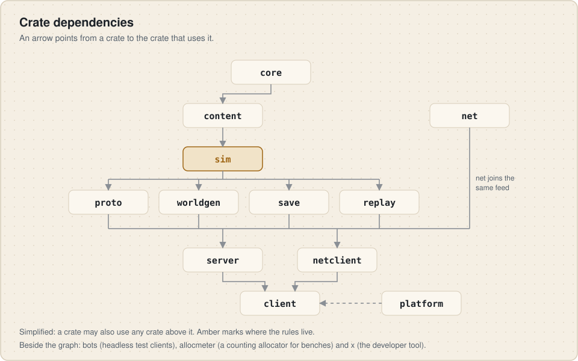
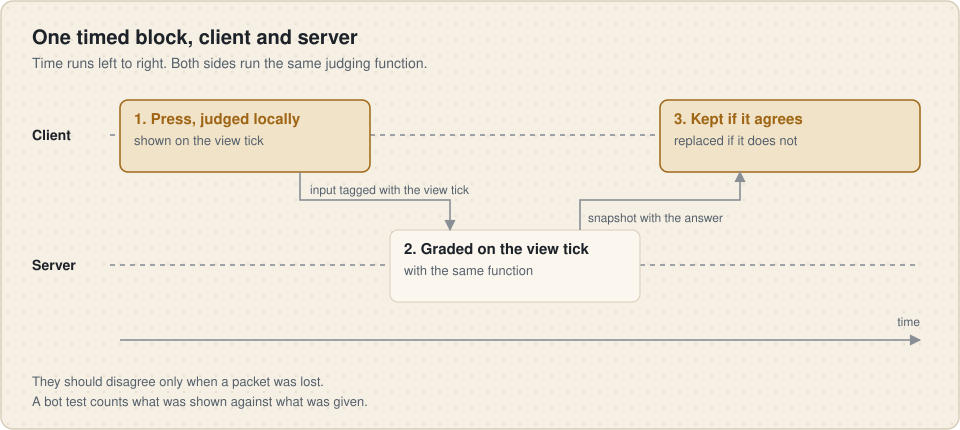

# Errastra engine notes

How the simulation under Errastra, a small co-op digging and fighting game written in Rust, gives the same world on every machine that runs it.

These are written notes. The engine's source is private, and nothing here is code from it.

## At a glance

- **What it is.** A 2D co-op sandbox on its own engine. One authoritative server loop runs single player, a listen server and a dedicated server. The simulation steps 60 times a second in fixed-point arithmetic, so the same inputs give the same world, bit for bit, on Windows and Linux.
- **My part.** I set the design and the rules the code has to keep, made the trade-offs, played each milestone and approved it. Claude Code wrote most of the code. The last section says how.
- **Stack.** Rust 1.94.1 (edition 2024), a Cargo workspace of 15 crates, postcard on the wire, zstd and BLAKE3 in saves, SDL3 and wgpu in the client, cargo-nextest, cargo-fuzz, and WSL2 for the Linux leg.
- **Three measured numbers**, all from 2026-11-24 on one desktop PC (Ryzen 9 5900X, Windows 11 Pro):
  - Server tick with 100 enemies: p99 of 361 us and 372 us in two runs, against a budget of 8,000 us.
  - The full gate on both systems: 3,599 tests on Windows, 1,751 on Linux, 1,850 Windows checks over the Linux leg's files, and the two state dumps identical over 14,397 lines, in 26.8 minutes.
  - Joining a generated planet: 506,592 bytes on the wire, 2.0 s at the 2 Mbit/s bulk cap.

<picture>
  <source media="(prefers-color-scheme: dark)" srcset="diagrams/crate-graph-dark.svg">
  
</picture>

## One server for every mode

Single player, a listen server and a dedicated server all run the same `Server`. In single player it sits in the game's own process behind an in-memory link. A listen server keeps the host in memory and lets other players join over UDP. A dedicated server is the same loop with no window.

There is no second, offline rule set. A blow in single player is graded by exactly the code that grades it online. I chose this so a rule can only be wrong in one place, and a bug found playing alone is a bug found for co-op as well.

The crates that hold the rules (`core`, `content`, `sim`, `proto`, `net`, `save`, `replay`, `server`, `netclient`, `bots`) build without SDL, a GPU or audio. A layering lint checks that on every gate, so the window can never creep into the simulation.

## Determinism, and how it is proved

The rules are short:

- The simulation steps at a fixed 60 ticks a second. The timing constants live in one file.
- No floating point in any state that is predicted, hashed or saved.
- No wall clock and no hash-map iteration in the simulation. Randomness comes from a seeded PCG32.
- `unsafe` is forbidden at the root of every headless crate. It appears in three places only: a counting allocator used by the bench and soak binaries, the GPU surface the client makes from its window, and a test-only allocator in the client.

A rule is only worth what checks it, so:

- The world has a digest over its state. A replay stores the commands the server applied, in order, with the digests to check them by.
- Goldens pin the world after 600 scripted ticks, and the final digest of a six-bot replay of 7,201 steps.
- The full gate runs a Windows leg that writes a save and a session, a Linux leg in WSL that checks them and writes its own, then Windows checks those. Last, the two state dumps are compared line by line.
- Four version numbers name every change of meaning: the rules, what the digest covers, the wire format, and the client's predicted state. The wire bytes are pinned in a file, so a format change without a version bump fails a test.

## Prediction and correction

The clearest example is a timed block, the game's defensive move, where a few frames matter.

<picture>
  <source media="(prefers-color-scheme: dark)" srcset="diagrams/tick-loop-dark.svg">
  
</picture>

1. The client runs the same judging function as the server, on its own frames. The result shows on the tick the blow lands on the player's screen, not a round trip later.
2. Inputs travel tagged with the view tick the player saw. The server finds the blow on that tick and grades the press with the same function.
3. The snapshot carries the server's answer. Where it differs from what was shown, the client replaces it, and a developer build logs each replacement.
4. A bot test drives a defender over a lossy link and counts what was shown against what was given. With shared code, the two sides should disagree only when a packet was lost.

A developer can also play single player at an ordinary home-internet ping, with delay, jitter and loss injected on the in-memory link (`--lag 150/20/1`).

## The gates

| Gate | What it checks | Last record |
|---|---|---|
| Goldens | The world after 600 scripted ticks, and the six-bot replay's final digest | Blessed 2026-11-24 |
| Replays | The server's every command, re-applied and checked tick by tick | A soak's recording replayed tick by tick, 2026-11-03 |
| Bots over lossy links | Six bots under Linux netem rules: 1% loss, 50 ms with 20 ms jitter, 150 ms with 5% loss, 300 ms with 5% loss, 10% loss, burst loss, duplication and reordering | All 8 rows passed, 2026-11-03, each with the kernel's counters showing it shaped packets (329 of 33,179 dropped at 1%, 4,176 of 36,990 at 10%) |
| Fuzzing | 16 targets over the three places untrusted bytes enter: the wire, saves and content files. Every decoder checks lengths before it allocates | 16 of 16 clean at 240 s each, 2026-11-03 |
| Soak | Six bots joining and leaving for 600 virtual minutes, with leaks judged per game day | Passed in 2,119 s of wall time, 2026-11-03 |
| Tick bench | 600 warm ticks, then 3,600 timed, every tick hashed, with a canary to refuse a busy machine | The table below, 2026-11-24 |

The tick bench on 2026-11-24, two runs of each scenario on the PC above (`cargo x tickbench`):

| Scenario | p50 | p99 | max | Allocations a tick |
|---|---|---|---|---|
| 6 players standing | 16 / 16 us | 57 / 54 us | 337 / 98 us | 153.2 |
| 100 enemies | 94 / 91 us | 361 / 372 us | 578 / 682 us | 417.0 |
| 6 players fighting 24 enemies | 34 / 33 us | 158 / 146 us | 288 / 231 us | 324.6 |
| A generated planet, 6 players walking | 56 / 52 us | 141 / 116 us | 444 / 240 us | 213.6 |

The budget is 8,000 us a tick, and every p99 sits under it by more than 20 times. The canary read 38,504 us and 38,480 us against a baseline of 37,517 us. A run whose canary is more than 3% off is thrown away, and one was (3.8% off). The digests matched the baseline's in every run.

## What was hard, and what I traded

- **Fixed point costs time.** No floats in decided state means no library maths for anything the server decides. It is slower to write, and the rule is held by a lint, not by memory.
- **The hash is not free.** Hashing every chunk every tick reaches 8.8 ms at p99 on a full planet, more than the whole tick budget. The bench times it apart from the tick for that reason.
- **Tails move between runs.** On 2026-11-24 the 100-enemy p99 read 361 us against an earlier baseline of 225 us, with the same digest and the same allocations to the digit. The same work, timed slower on the day. It is still open.
- **The full gate is slow.** Both systems, every step, took 26.8 minutes. It runs before every merge anyway.
- **Saves trust the file system.** Writes go to a temporary file, are flushed and renamed. On Linux the folder is flushed too. On Windows it is not, and the save relies on NTFS replaying its journal after a power cut. On exFAT or FAT32 that guarantee is gone, so worlds belong on NTFS.

## Not verified

- **Present latency.** From the vsync settings it should be 6.1 to 18.2 ms at 165 Hz. It has not been measured on the played window.
- **Real players on real networks.** The lossy-link results come from bots and netem rules. A live two-player test is next.
- **Other machines.** Every timing here is from one desktop PC. The gate compares Windows and Linux (WSL2) on that same PC, so a different CPU has not been part of it.
- **Save sizes on real planets.** The early chunk sizes (median 62 bytes a chunk compressed, 2026-10-28) came from a mostly uniform test map. Generated planets will compress worse.

## Sources

Every number is quoted from the project's dated records, not re-measured for these notes: a milestone review and its bench run (2026-11-24), the full gate at that merge (2026-11-24), a milestone gate and its night run (2026-11-03), and a benchmark note (2026-10-28).

## How this was made

Claude Code wrote most of the engine's code under my direction. I set the design, made the decisions, reviewed the results and approved each stage. Nothing lands without passing the tests and the benchmarks. The independent reviews are done by separate AI reviewer agents, working read-only with fresh context, and I read their reports and rule on the findings before a merge.

These notes were drafted with Claude Code from those records. Every figure is quoted from them.
